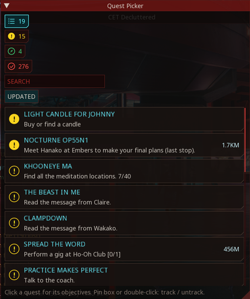

# Quest Picker

A Cyber Engine Tweaks window, styled after the 2.5 journal, for choosing the tracked quest without opening the pause menu, for Cyberpunk 2077. Single-player only.
Version 1.1.0 | For game version 2.5 | Status: 1.0.1 in use in my game and working; 1.1.0 (time skip line) tested in game, not extensively; the offline mock test passes (156 of 156 checks)

**Download:** [latest release](https://github.com/penicius-code/cp2077-quest-picker/releases/latest) (zip; install steps below)

> This is an unofficial fan work and is not approved/endorsed by CD PROJEKT RED. No game files are included.



## The problem

Switching the tracked quest means pausing, opening the journal, finding the right tab and scrolling to the quest. Doing that often, for example to compare which gig is nearest, breaks the flow of play.

## What I built

A CET window with the same lists as the journal: tabs with counts, search, sort by last update or by distance, and a details pane. A line under the header shows the game day and clock and whether time skip is possible right now, and why not when it is blocked. A click on the pin box tracks or untracks a quest. It changes: which quest and objective the game tracks, through the game's own journal functions. 1,031 lines of Lua, no redscript.

**This published build differs from the one installed on the author's PC in one point.** The installed build untracks through a function that exists only in a locally patched copy of the Keep Tracked Quest mod. Here that call is guarded: if the function is missing or fails, the quest is untracked through the game's journal instead, as it already was without Keep Tracked Quest. With an unpatched Keep Tracked Quest the installed build raised an error at the UNTRACK button; this build does not.

## How it works

- Tabs follow the journal: All (active), Quests (main and side jobs), Gigs (gigs, NCPD, cyberpsychos, apartments, courier) and Done (completed and failed), each with a count.
- A row shows the type, the title, the first active objective (with counters and "Optional" like the journal) and the distance to the nearest map pin. Search looks at the title and the first objective.
- Click a row: after a short delay the details open with the active objectives (click one to track that objective), the done objectives and the description. The pin box at the end of a row, or a double-click, tracks the quest's first non-optional objective. The pin box on the tracked quest untracks it.
- With a window 820 pixels wide or more, the details sit beside the list; narrower, below it.
- Keep Tracked Quest is optional. When it is installed, tracking runs between its `BeginPlayerAction` and `EndPlayerAction` calls, so a pick made here counts as the player's own choice for that mod.
- Cost: no `onUpdate`, no hooks, no keys. Drawing stops at once while the CET overlay is closed. While it is open, active quests are re-read every 1.5 seconds, finished quests once per overlay open, texts are cached per journal entry, and only the rows inside the scroll view are drawn.

```text
package/
  bin/x64/plugins/cyber_engine_tweaks/mods/CyberslopQuestPicker/init.lua
tests/mock.lua    runs the Lua against a stubbed game API (156 checks)
```

Run the test from an empty folder, because it writes the mod's settings file into the current folder: `luajit <repo>/tests/mock.lua <repo>/package/bin/x64/plugins/cyber_engine_tweaks/mods/<mod folder>/init.lua`.

## Requirements

| Requirement | Version | Link |
|---|---|---|
| Cyberpunk 2077 | 2.5 | |
| Cyber Engine Tweaks | a build for 2.5 | [Nexus Mods, mod 107](https://www.nexusmods.com/cyberpunk2077/mods/107) |
| Keep Tracked Quest by Aeoniums (optional) | | [Nexus Mods, mod 38954](https://www.nexusmods.com/cyberpunk2077/mods/38954) |

No other mod is needed. Requirements are not bundled.

## Install

1. Install the requirements above.
2. Download the zip from the [latest release](https://github.com/penicius-code/cp2077-quest-picker/releases/latest) (the same files as `package/` in this repository) and extract it into the game folder, so that `bin\x64\plugins\cyber_engine_tweaks\mods\CyberslopQuestPicker\init.lua` exists.
3. Start the game, load a save and open the CET overlay. The "Quest Picker" window lists your active quests. In the main menu it says "Load a save to see your quests."

## Uninstall / roll back

1. Close the game.
2. Delete `bin\x64\plugins\cyber_engine_tweaks\mods\CyberslopQuestPicker\` (this also removes its `config.json`).
3. Saves are not affected: the mod only calls the game's own tracking. The quest tracked last stays tracked.

## Configuration

The selected tab and the sort order (last update or nearest) are remembered in `config.json` next to `init.lua`. There are no other settings.

## Status

| What | Result |
|---|---|
| In game, 1.0.0 | Tested, not extensively. |
| In game, 1.0.1 | In use in the author's game and working (author's statement, 2026-11-24). Tested, not extensively. The author's game runs the installed build, which differs from the published one in the untracking call (see Engineering notes). |
| In game, 1.1.0 | Tested in game, not extensively. |
| Mock test | 156 of 156 checks pass with LuaJIT on this published 1.1.0 build (1.0.1: 129 of 129), also in CI. The test replaces CET, ImGui and the journal with stubs and checks tabs, counts, search, sort, details, tracking, untracking, config, error handling and the ImGui push/pop balance every frame. It runs in CI. |
| Lua syntax | LuaJIT compiles the file. |

The stock Keep Tracked Quest case (without the patched function) was checked with a variant of the mock test that is not part of this repository: the published build untracks through the journal without an error; the installed build raised "attempt to call method 'ToggleByKey' (a nil value)".

## Compatibility

| Item | Status | Notes |
|---|---|---|
| Keep Tracked Quest (stock) | handled | Tracking goes through its player-action calls; untracking falls back to the journal. |
| Without Keep Tracked Quest | works | The journal is called directly. |

## Known issues

- The version string inside `init.lua` reads 1.0.0 (written to the CET log at start); the file is 1.0.1.
- The journal calls follow the 2.5 game scripts; there is no written record of them being tried in game. A failing call shows a red line in the window and one line in the mod's log; the game keeps running.

## Engineering notes

**Problem.** Before publishing, a review of the installed build looked for calls into other authors' mods. The UNTRACK button and the pin box on the tracked row both called `ToggleByKey` on Keep Tracked Quest's system. That function exists only in a locally patched copy of Keep Tracked Quest, not in the published mod.

**Diagnosis.** With the stock mod installed, `ktq()` finds the system, so the code takes the Keep Tracked Quest path and calls a method that is not there. The variant of the mock test without `ToggleByKey` on the stub system reproduced it: 6 failed checks with "attempt to call method 'ToggleByKey' (a nil value)", and nothing untracked.

**Fix.** The call is made inside a protected call. If the system is absent, the method is missing or the call fails, `untrack()` uses the journal's own `UntrackEntry`, which the code already used without Keep Tracked Quest. Hiding the button was not enough, because the pin box on the tracked row reaches the same function.

**Check.** The original mock test gives 129 of 129 on the installed file and on the published file. The stock-mod variant gives 127 passed and 2 failed on the published file; the 2 are the checks that expect untracking through `ToggleByKey`, and the journal untrack happens with no error.

**Earlier fix (1.0.1).** TRACK and UNTRACK now pop their button colours before they call the game, so an error in that call cannot leave colours pushed on every other CET window.

**Rollback.** For a user: delete one folder.

## Changelog

See [CHANGELOG.md](CHANGELOG.md). Latest: 1.1.0 (2026-11-26): a time skip line under the header shows the game day and clock and whether time skip is possible now, with the reason when it is blocked.

## Credits and licence

Runs on Cyber Engine Tweaks, which is not included here. Works with Keep Tracked Quest by Aeoniums when it is installed.

MIT, see [LICENSE](LICENSE). The licence covers my code only. Game names and trademarks belong to their owners.

Built with AI assistance (Claude); designed, tested and maintained by me.
